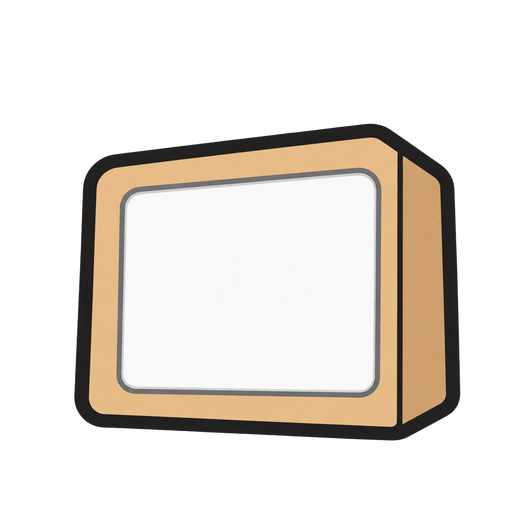

#  Papershow

An e-ink slideshow for an 800×480 black-and-white panel (Waveshare 7.5″). You draw pictures and set up apps (clocks, AI text, news, prices) in the browser, arrange them into a show, and the panel fetches whatever is on air from `/live`.

All the work happens on the server. The panel never renders anything: it downloads a finished 1-bit frame and redraws only when that frame changes, because e-ink refreshes are slow and flash.

## Install on a Raspberry Pi

On a Pi 5 with 64-bit Raspberry Pi OS and the panel attached, run this one line:

```sh
command -v gh >/dev/null || { sudo apt-get update && sudo apt-get install -y gh; }; gh auth status >/dev/null 2>&1 || gh auth login; gh api repos/Diogomartf/papershow/contents/deploy/pi/install.sh -H "Accept: application/vnd.github.raw" | bash
```

It signs in to GitHub if needed (the repo is private), installs everything, offers to set up Tailscale, and starts the panel. Run it again to update. The details are in [On a Raspberry Pi](#on-a-raspberry-pi).

## Where it runs

- **For real, on a Raspberry Pi 5** with the panel attached. The Pi runs the server and drives the panel, and starts both on boot. You open Papershow from your Mac or phone. See [On a Raspberry Pi](#on-a-raspberry-pi).
- **For development, on your Mac.** See [Develop on your Mac](#develop-on-your-mac). There's no panel there: `/live` in a browser tab shows what it would show.

## Open Papershow

| Where it runs | From | Address |
|---|---|---|
| Raspberry Pi | Any device on your home Wi-Fi | `http://papershow.local:5194` (your Pi's hostname, and port if you changed it) |
| Raspberry Pi | Anywhere, through [Tailscale](#4-reach-it-from-anywhere) | `https://papershow.<your-tailnet>.ts.net` |
| Your Mac (`pnpm dev`) | The Mac | http://localhost:5193 |
| Your Mac (`pnpm dev`) | A phone on the same Wi-Fi | `http://<your-mac's-ip>:5193` |

On a phone, use the Tailscale address even at home: it's HTTPS, which Draw needs on phones, and it's the same address everywhere. Add it to the home screen and it opens like an app. The device needs the Tailscale app, signed in to the same account. Some Android phones can't resolve `.local` names; use the Pi's IP (`hostname -I` on the Pi) or the Tailscale address.

## Dependencies

**On the Pi**, the install script sets all of this up. You only need the hardware and the OS.

| What | For | How it's installed |
|---|---|---|
| Raspberry Pi 5, 64-bit Raspberry Pi OS (Bookworm or later) | Everything | You, with Raspberry Pi Imager |
| Waveshare 7.5″ e-Paper V2 HAT (800×480, black and white) | The panel | You, on the GPIO header |
| `git`, `gh` | Getting the code from the private repo | apt, by the one line |
| Node 24 | The server (needs `node:sqlite`, 22.13 or later) | NodeSource apt repo, only if the Pi's Node is older |
| pnpm 7 | Installing and building | `npx pnpm@7`, nothing installed globally |
| `python3-pil`, `python3-spidev`, `python3-gpiozero`, `python3-lgpio` | The panel client and its SPI and GPIO on a Pi 5 | apt |
| SPI | Talking to the panel | `raspi-config` |
| Waveshare's `epd7in5_V2` driver | Drawing on the panel | In the repo (`apps/panel/waveshare_epd`) |
| Tailscale (optional) | Opening Papershow from anywhere, over HTTPS | Its install script, if you say yes |

**On your Mac**, for development: Node 22.5 or later and pnpm 7.

**Libraries**, installed by pnpm from `pnpm-lock.yaml`:

| Package | Used for |
|---|---|
| [Hono](https://hono.dev) | The server's HTTP routes |
| [satori](https://github.com/vercel/satori), [resvg-js](https://github.com/yisibl/resvg-js) | Rendering apps: JSX to SVG to pixels |
| [fast-png](https://github.com/image-js/fast-png) | Encoding the 1-bit PNGs |
| tsx | Running the server's TypeScript directly, with no build step |
| Inter, Source Serif 4, UnifrakturMaguntia (`@expo-google-fonts`) | Fonts on the panel |
| React 19, Vite | The web app |
| [drawesome](https://www.npmjs.com/package/drawesome) | Draw's pens, eraser and undo |
| oxlint, TypeScript | Checking the code |

The panel client uses only Python's standard library and Pillow.

## Develop on your Mac

Needs Node 22.5 or later (the server uses the built-in `node:sqlite`) and pnpm 7, the version that wrote `pnpm-lock.yaml` (newer ones can't read it; `npx pnpm@7` works too).

```sh
pnpm install
cp .env.example .env     # optional: API keys for the AI apps, Stocks and stock logos
pnpm dev                 # web on :5193, server on :5194
```

Open http://localhost:5193. The dev server listens on your network too, so phones (and the panel) on the same Wi-Fi can reach it.

Production is one Node process that serves both the API and the built web app:

```sh
pnpm build               # builds apps/web into apps/web/dist
pnpm start               # NODE_ENV=production; serves the web app and the API on :5194
```

## On a Raspberry Pi

One Raspberry Pi 5 runs both the server and the panel client, with the panel on its GPIO header. You open Papershow from your Mac or phone, at home or away, over Tailscale.

In short: flash Raspberry Pi OS and run one line on the Pi. It installs everything, sets up Tailscale if you want it, and starts the panel. Copying your `.env` over is optional. The steps below say where each command runs: **on your Mac** or **on the Pi** (after `ssh` into it).

### Already have a Pi?

You don't need a fresh card. Papershow installs next to whatever else the Pi runs, as long as it's a **Pi 5 on 64-bit Raspberry Pi OS** (`uname -m` says `aarch64`). Skip step 1, `ssh` in as usual, and start at [step 2](#2-on-the-pi-install). The one line puts the checkout in `~/papershow` (`PAPERSHOW_DIR` to change it), or clone it yourself anywhere and run `deploy/pi/install.sh`.

What the install script changes, and what it leaves alone:

- **Port**: it uses 5194, and stops if something else is already on it. Pick another with `PAPERSHOW_PORT=8080 deploy/pi/install.sh`.
- **Address**: your Pi keeps its hostname, so Papershow is at `http://<hostname>.local:5194`. The script prints the address when it's done.
- **Node**: it installs Node 24 only if the Pi's Node is older than 22.13, and that upgrade is system-wide. A newer Node is left alone.
- **pnpm**: it runs pnpm 7 through `npx`, so a pnpm the Pi already has stays as it is.
- **SPI** gets turned on. Python libraries come from apt and don't replace anything.
- **Tailscale**: if the Pi already serves something through `tailscale serve`, that setup is left alone, and the script prints the command to add Papershow on port 8443.
- **The panel**: nothing else may drive it. Old e-ink scripts on cron get a warning but aren't removed: take them out with `crontab -e`. If you used [pi-e-ink](https://github.com/Diogomartf/pi-e-ink), that's its `clean.py`, `tokens.py`, `stocks.py` and `ai_clock.py` lines. The deep clean, the 180° rotation and the night pause now live in Papershow.
- **Data** goes in `/var/lib/papershow`, outside your checkout.

### You need

- A Raspberry Pi 5 with a power supply and a microSD card.
- A Waveshare 7.5″ e-Paper V2 (800×480, black and white) with its HAT, seated on the GPIO header.
- A [Tailscale](https://tailscale.com) account, to reach it from outside your home.

### 1. On your Mac: flash the card

In [Raspberry Pi Imager](https://www.raspberrypi.com/software/), pick **Raspberry Pi OS Lite (64-bit)**. Under *Edit settings*, set the hostname to `papershow`, create your user, add your Wi-Fi, and turn on SSH. Put the card in the Pi, seat the panel's HAT, and power it on. A minute later, log in to it from your Mac:

```sh
ssh <user>@papershow.local
```

Every "On the Pi" step runs in this session.

### 2. On the Pi: install

One line. It installs GitHub's `gh` if it's missing and asks you to sign in if you aren't yet (the repo is private). Then it clones the repo to `~/papershow`, installs, and offers to set up Tailscale:

```sh
command -v gh >/dev/null || { sudo apt-get update && sudo apt-get install -y gh; }; gh auth status >/dev/null 2>&1 || gh auth login; gh api repos/Diogomartf/papershow/contents/deploy/pi/install.sh -H "Accept: application/vnd.github.raw" | bash
```

Run the same line again to update. Inside a checkout, `deploy/pi/install.sh` does the same thing.

The script installs Node 24 and pnpm, builds the web app, turns on SPI, installs the panel's Python libraries, and sets up two services that start on boot:

| Service | What it runs |
|---|---|
| `papershow` | The server: web app, API and `/live` on :5194. Data in `/var/lib/papershow/papershow.db`. |
| `papershow-panel` | The panel client: shows the logo, then follows `/live` and draws it. |

The panel shows the logo, then the current frame. Papershow is now at `http://papershow.local:5194` on your home network, and it all starts again on its own after a reboot or power cut.

### 3. On your Mac: add your API keys (optional)

Without keys, the AI apps and Stocks show stand-in content. To use yours, copy your `.env` over from the repo on your Mac and restart the server:

```sh
scp .env <user>@papershow.local:~/papershow/.env
ssh <user>@papershow.local sudo systemctl restart papershow
```

### 4. Reach it from anywhere

The install asks whether to set up Tailscale. Say yes, open the link it prints to log in, and it ends with the address, `https://papershow.<tailnet>.ts.net`. Open it on any device signed in to your tailnet. On a phone, add the page to the home screen.

`tailscale serve` needs MagicDNS and HTTPS certificates turned on in the Tailscale admin console (DNS page). If you said no, run the install line again later.

### 5. On your Mac: bring your drawings and shows (optional)

Stop the dev server, then copy the database across:

```sh
scp apps/server/data/imagegen.db <user>@papershow.local:/tmp/
ssh <user>@papershow.local 'sudo systemctl stop papershow &&
  sudo cp /tmp/imagegen.db /var/lib/papershow/papershow.db &&
  sudo chown $USER: /var/lib/papershow/papershow.db &&
  sudo systemctl start papershow'
```

### 6. In the browser: set the night

Open Papershow. On the Dashboard, under **Device**, set the night hours (for example 01:00–10:00) and what the panel shows while asleep. The panel also deep-cleans itself as night begins.

If the Pi used to run e-ink scripts from cron, remove them (`crontab -e`). Only one thing may drive the panel, and the install script warns if it finds any.

### Updating

On the Pi, run the [one line](#2-on-the-pi-install) again, or:

```sh
cd ~/papershow && git pull && deploy/pi/install.sh
```

### Panel settings

Change these with `sudo systemctl edit papershow-panel`, which keeps them across reinstalls:

```ini
[Service]
Environment=PANEL_PARTIAL=0
```

| Variable | Default on the Pi | What it does |
|---|---|---|
| `PAPERSHOW_URL` | `http://localhost:5194` | The server to follow. |
| `PANEL_ROTATE` | `180` | Degrees to turn the frame. The frame holds the panel upside down. |
| `PANEL_PARTIAL` | `10` | Quick partial refreshes in a row before a full one. `0` makes every refresh full, if partials leave ghosts. |
| `PANEL_CLEAN_HOUR` | `3` | Hour of the daily deep clean when night mode is off. |

### When something's off

- Logs: `journalctl -u papershow -f` and `journalctl -u papershow-panel -f`.
- The Dashboard's **Device** card shows when the panel last fetched `/live`.
- Panel blank or stuck: check that SPI is on (`ls /dev/spidev0.0`) and that the HAT is seated, then `sudo systemctl restart papershow-panel`.
- Try the client without a panel, on any machine: `PANEL_OUT=/tmp/panel.png python3 apps/panel/panel.py`.

### How the panel client works

- It long-polls `/live.bin`, so it redraws as soon as the show changes and never in between. When the same app changes (a clock ticking), it uses a quick partial refresh. A new picture, or every `PANEL_PARTIAL`-th tick, gets a full refresh to clear ghosting. Between frames the panel sleeps.
- Once a day, as night begins, it deep-cleans the panel against ghosting: white, black, white, then the picture again.
- On every start it shows the logo until the first frame arrives. That's `apps/panel/splash.png`, drawn by `apps/server/src/splash.tsx` (run `npx tsx src/splash.tsx` in `apps/server` after changing the logo).
- If the server can't be reached, it keeps the current picture and retries every 30 s.
- `apps/panel/waveshare_epd` is a copy of Waveshare's driver (MIT) that's known to work on this panel. Upstream has since changed the panel voltages, so update it only after testing.

## Architecture

```
 Browser (apps/web)                         Server (apps/server)                       Panel
 ─────────────────                          ────────────────────                       ─────
 Draw ── renders the drawing itself ──PUT──▶ images table (scene + png/mono/bin)
 Apps ── settings ───────────────────PATCH─▶ apps table ── data() ─▶ JSX ─▶ satori ─▶ resvg ─▶ 1-bit
 Show / Playlists ── order, times ───PUT───▶ show, playlists, slides tables
                                              │
 Dashboard ◀── /api/state/wait (long-poll) ───┤  schedule.ts: (show, now) → what's on air
                                              ▼
                                            /live ── 1-bit PNG / raw 1bpp ── long-poll ──▶ draws when the ETag changes
```

### Repository

| Path | What it is |
|---|---|
| `apps/web` | Vite + React front end: Dashboard, Show, Playlists, Apps, Draw. |
| `apps/server` | Hono on Node: API, SQLite store, scheduler, app renderer, `/live`. |
| `apps/server/src/apps` | One file per app (clock, AI, news, crypto, stocks…). See [AGENTS.md](AGENTS.md) for how to write one. |
| `apps/panel` | The Pi client: follows `/live.bin` and draws it on the Waveshare panel. Python, not part of the pnpm workspace. |
| `packages/scene` | Shared by web and server: the drawing's `Scene` type, `dither`, `enhance` and `pack1bpp`. |
| `deploy/pi` | Install script and systemd units for running everything on a Raspberry Pi 5. |
| `.env.example` | API keys; copy to `.env` at the repo root. |

The panel client only knows a server URL, so it can follow a server on the same Pi, on your tailnet, or anywhere else. Anything that can fetch `/live.bin` and write 48,000 bytes to a display works (see [The panel's contract](#the-panels-contract)).

### Two ways a frame gets made

**Drawings are rendered in the browser.** Draw is a canvas editor (the [drawesome](https://www.npmjs.com/package/drawesome) pens plus a text layer). On save, the browser renders three files from the scene: a colour PNG, a 1-bit PNG and the panel's raw 1bpp frame. It uploads them with the scene JSON to `PUT /api/images/:id`. The server stores them as they are.

**Apps are rendered on the server, on demand.** Each app is a TypeScript module with a `data()` function (fetch prices, ask a model…) and a `view()` that returns JSX. The pipeline:

```
data(config, now) → view(...) JSX → satori (layout, text to paths) → SVG
  → resvg (rasterise 800×480) → dither or threshold to 1 bit → mono PNG + packed 1bpp
```

A frame is rendered at most once per *period* (a clock every minute, news every 15 minutes, an AI app as its settings say), aligned to the wall clock, and cached. Every request in that period gets the same frame, and the dashboard can render "how it will look at 14:00" ahead of time with the same alignment.

Photos and logos are prepared for e-ink one by one before layout (`ditheredImage` in `apps/server/src/render.ts`): levels stretched, contrast curved, edges sharpened (`enhance`), then Atkinson-dithered at their exact size. The rest of the frame then uses a plain threshold, so text stays crisp next to a dithered photo.

### What's on air

`apps/server/src/schedule.ts` is a pure function: given the show, the time and any pin, it says what's on `/live` and when that changes. It doesn't need a timer, so every client asking at the same moment gets the same answer.

- **The show** is a list, played top to bottom and then again. Each entry is either a **playlist** (its clips in order) or a **single drawing or app** with its own duration.
- **Playlists** hold clips. Each clip has a duration, weekdays and an optional time window (for example 07:00–09:00, which can wrap past midnight). Clips outside their window are skipped.
- **Repeats**: a single entry can instead run *on the clock*, every 15, 30, 60, 120 or 180 minutes from midnight, interrupting the loop for its duration. The loop keeps time underneath and resumes where the clock says.
- **Pin** ("Show now"): holds one drawing or app on `/live` until you go back to the loop.
- **Night**: sleep hours during which the panel shows a moon and the wake-up time, goes blank, or keeps its last picture.

The rotation runs on wall-clock time: the position in the cycle comes from `now % cycle length`. A restart doesn't change what's on air.

Anything that edits the show, images, apps or the pin wakes the long-polls, so the dashboard and the panel update at once.

### Storage

SQLite at `apps/server/data/imagegen.db` (set `DB=/path` to move it). Tables: `images` (scene JSON plus the three rendered files), `apps` (kind, name, settings JSON), `playlists`, `slides` (playlist clips), `show` (entries, durations, repeats), `settings` (pin and night). The draft you're drawing stays in the browser's IndexedDB until you save.

## Sections

The nav runs Dashboard, Show, Apps, Draw. Every page has the light switch (the page dims after sunset on its own; the switch holds until the next sunrise or sunset) and a live thumbnail of the panel, linking to `/live`.

### Dashboard (`/`)

What's on the panel now: the frame, its name, which playlist it's from, and a progress bar for the current clip. When the panel changes picture, the frame plays a full e-ink refresh (old picture inverted, black, white, black, new picture inverted, then settled) instead of cutting. Below it:
- **Up next**: the next clip and how it will look when it airs. It's rendered ahead, so a clock shows the right time.
- **Device**: night hours and what the panel shows while asleep, plus when a display last fetched `/live`.
- **Sequence**: the next hour or so of the loop, with what plays when.

### Show (`/show`)

The running order. Add playlists, or single drawings and apps, then reorder them, set durations, switch entries on or off, or set a single entry to repeat on the clock. The header shows how long one pass of the loop takes. Under **Add to the show**, each playlist is a card with a glimpse of its first three clips stacked like a deck, its item count and its length.

### Playlists (`/playlist/:id`)

One playlist as a timeline, with the live picture on top. Drag drawings and apps from the strip into it (on phones: tap to add, tap to reorder). Select a clip and two things open: a small menu above it (**Show now**, **Earlier**, **Later**, **Remove**) and its settings below the timeline (duration in minutes, weekdays, time window, in the loop or not). Clicking anywhere else, or Esc, lets go of it. Tabs across the top switch between playlists. Double-click a tab to rename it. Zoom with the buttons, pinch, or ⌘/Ctrl + wheel. While dragging, a glowing gap shows where the clip will land.

### Apps (`/apps`)

Your app instances on the left, with live thumbnails, and **New app** grouped by category. The middle shows a preview that updates as you type. Switch it between **E-ink** (exactly what the panel shows) and **Original** (the full-colour render at 2×, before it's reduced to 1 bit). On the right are the app's settings, with **Show now**, **Add to the show**, **Duplicate** and **Delete**. Each app's settings name where its data comes from, and show a **Mock data** chip while it's running on stand-in content.

Some apps take a few seconds the first time, because they fetch before they can draw: Stocks asks Massive for movers, closes and company names and logo.dev for logos; Crypto asks CoinGecko and Trust Wallet. While a preview renders, the panel shows an e-ink loader with "Loading Stocks…" (or a small "Updating…" pill over the current picture when you change a setting). The loader only appears after a moment, so fast renders don't flicker. If a render fails, the panel says so instead of staying blank. Everything that doesn't change is cached after the first render.

| App | Category | Data from | Key | New frame |
|---|---|---|---|---|
| Clock (Small / Medium / Large, 12/24-hour, date) | Clocks | This device's clock | — | every minute |
| AI Clock (a poem about the time; editable prompt with `{time}`) | Clocks | Groq | `GROQ_API_KEY` | every minute |
| Word of the day | AI | Groq | `GROQ_API_KEY` | daily (adjustable) |
| Fun fact | AI | Groq | `GROQ_API_KEY` | hourly (adjustable) |
| Haiku (knows the season and time of day) | AI | Groq | `GROQ_API_KEY` | hourly (adjustable) |
| Quote of the day | AI | Groq | `GROQ_API_KEY` | daily (adjustable) |
| Custom AI (any prompt, any layout) | AI | Groq | `GROQ_API_KEY` | hourly (adjustable) |
| New York Times (lead story and photo, 7 sections) | News | NYT RSS feeds | — | 15 min |
| Wall Street Journal (latest story and photo, 7 sections) | News | WSJ RSS feeds (Dow Jones) | — | 15 min |
| Techmeme (top story, or top 3) | News | techmeme.com "Top News" column | — | 15 min |
| Crypto (up to 4 of 10 tokens, USD/EUR) | Stocks & tokens | CoinGecko prices, Trust Wallet logos | — | 5 min |
| Stocks (top gainers or losers) | Stocks & tokens | Massive, logos from logo.dev | `MASSIVE_API_KEY`, `LOGO_DEV_TOKEN` (logos) | 15 min |

Details per source:
- **Groq**: `openai/gpt-oss-20b` by default (`GROQ_MODEL` to change it). Each AI app has a model picker filled from Groq's live model list. The same prompt in the same period is asked once. A key Groq rejects counts as missing until the server restarts.
- **NYT**: `rss.nytimes.com/services/xml/rss/nyt/<Section>.xml`. The first item of `HomePage` is the story leading the front page.
- **WSJ**: `feeds.content.dowjones.io/public/rss/<Feed>`. There's no front-page feed, so it shows the newest item in the section.
- **Techmeme**: parses the homepage's "Top News" column, because the RSS feed is newest-first rather than ranked.
- **CoinGecko**: the free `simple/price` endpoint, one call for all tokens and both currencies, shared for a minute. Logos come from `assets-cdn.trustwallet.com/blockchains/<chain>/info/logo.png` for a chain's own coin, or `/<chain>/assets/<address>/logo.png` for a token on it.
- **logo.dev**: company logos by ticker (`img.logo.dev/ticker/<SYMBOL>`), fetched once each and dithered into the badge's rounded square. Without `LOGO_DEV_TOKEN`, or for a ticker logo.dev doesn't know, Stocks shows the drawn ticker badge.
- **Massive**: live top movers on the Starter plan and above. On the free plan, it works out the previous session's movers from daily closes (stocks over $5 that traded over a million shares).

Every source keeps its last good result if a fetch fails. The news apps read unofficial public feeds and pages, and only ever use the headline, summary, byline and photo.

### Draw (`/draw`)

A drawing board the size of the panel. Pens, eraser, undo and swatches come from drawesome. **Text** (or `T`) switches to typing: click to add text, drag to move it with centre guides, pull a corner to scale it. **Ink / E-ink** previews the drawing as the panel will show it, with the swatches cut down to black and white. **Save & open** (⌘S) stores it on the server and opens its page. **Gallery** reopens or deletes saved drawings, or puts one on `/live`. The draft autosaves in the browser.

### Image page (`/i/:id`)

A saved drawing on its own, to look at, drag out or download.

### `/live`

What the panel shows right now, as a 1-bit PNG. Open it in a tab to watch it.

## The interface, e-ink first

The web app looks like the device it drives: the panel sits in a wooden frame on a shelf, and the page dims after sunset. A few pieces carry the e-ink feel and are shared:

| Piece | Where | What it does |
|---|---|---|
| `EinkImage` | Dashboard, Playlist | Swaps the live picture with a full e-ink refresh, in hard steps. The new picture is decoded first, so the flash never lands on a blank frame. Reduced motion: a plain swap. |
| `Blocks` | Apps preview | The loader: a 3×3 grid of rounded "pixels" flipping out of step between paper, ink and a dithered ghost, in hard steps. |
| `LiveLink` | Every page | A live thumbnail of the panel with "Open /live" under it. All live views in a tab share one long-poll. |
| `FloatingMenu`, `MenuItem` | Playlist clips, Dashboard sequence | Small action menus on the theme's surface, with icons and a separate, red **Remove**. |
| `LightSwitch` | Every page | Light and dark follow the sun; a flip holds until the next sunrise or sunset. |
| E-ink / Original | Apps preview, Draw (Ink / E-ink) | See exactly what the panel will show, or the full-colour version. |

## The panel's contract

| Request | Returns |
|---|---|
| `GET /live` or `/live.png` | 1-bit PNG, 800×480 |
| `GET /live.bin` | 48,000 bytes: 1 bit per pixel, MSB first, 1 = white, rows top to bottom |

Response headers:
- `ETag`: changes only when the pixels do.
- `X-Next-Change`: seconds until the frame changes by itself, if it will.
- `X-Sleep-Until`: while asleep, when the panel wakes (ms since epoch).

Long-poll: send `?wait=1` with `If-None-Match: <etag>`. The server holds the request for up to 55 s and answers as soon as the frame changes, or with `304` if it didn't. A `204` means keep the last picture (asleep with "keep last picture"). Requests without `?e=` count as a display checking in, which the dashboard shows. The web app's own previews add `?e=`.

## API

| Method and path | What it does |
|---|---|
| `GET /api/state`, `GET /api/state/wait` | Everything the admin shows: on air, show, playlists, clips, sequence, night. `wait` long-polls up to 25 s. |
| `GET /api/images`, `GET /api/images/:id` | Saved drawings; one drawing with its scene. |
| `GET /api/images/:id/:kind` | `png`, `mono` or `bin` file. |
| `PUT /api/images/:id`, `DELETE /api/images/:id` | Save (multipart: `scene`, `png`, `mono`, `bin`) or delete. |
| `GET /api/apps/catalog` | App kinds: name, category, source, settings fields, defaults, mock. |
| `GET /api/apps`, `POST /api/apps` | Your app instances; create one (`{ kind, name?, config? }`). |
| `GET`, `PATCH`, `DELETE /api/apps/:id` | One instance. |
| `GET /api/apps/:id/:kind` | Its current frame: `png`, `mono` or `bin`. |
| `POST /api/apps/preview` | Render unsaved settings (`{ kind, config, original? }`); `original` returns the colour render at 2×. |
| `GET /api/frame/:kind/:id?at=` | A drawing or app as it will look at a given time (the dashboard's sequence). |
| `POST`, `PATCH`, `DELETE /api/slides…`, `PUT /api/slides/order` | Playlist clips. |
| `POST`, `PATCH`, `DELETE /api/playlists…`, `PUT /api/playlists/order` | Playlists. |
| `POST`, `PATCH`, `DELETE /api/show…`, `PUT /api/show/order` | Show entries, durations, on/off, repeats. |
| `PUT /api/live` | Pin a source (`{ mode: "pin", source }`) or go back to the loop (`{ mode: "rotate" }`). |
| `PUT /api/sleep` | Night: `{ enabled, start, end, screen: "moon" \| "blank" \| "off" }`. |

Edits answer with the whole new state, so the UI never drifts from the server.

## Configuration

`.env` at the repo root (see `.env.example`):

| Variable | For |
|---|---|
| `GROQ_API_KEY` | AI apps and AI Clock. Without it they show stand-in text. |
| `GROQ_MODEL` | Default model for AI apps (`openai/gpt-oss-20b`). |
| `MASSIVE_API_KEY` | Stocks. Without it the app shows stand-in movers. |
| `LOGO_DEV_TOKEN` | logo.dev publishable key (`pk_…`) for company logos in Stocks. Without it, ticker badges. |
| `PORT` | Server port (5194). |
| `DB` | SQLite file (`apps/server/data/imagegen.db`). |

The server reads `.env` when it starts, so restart it after changing keys.
